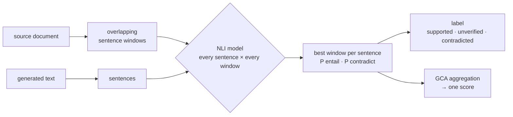

# 🔎 factlens

[](https://github.com/hasnat23/factlens/actions/workflows/ci.yml)
[](https://www.python.org/downloads/)
[](HF_SPACE_URL)
[](LICENSE)

**Which sentence of your LLM's summary is hallucinated?** factlens checks every sentence of a generated summary or RAG answer
against its source with an NLI model, labels it **supported / unverified / contradicted**, points to the best supporting evidence,
and aggregates everything into one factual-consistency score.

🤗 **[Try the live demo](HF_SPACE_URL)**

```python
from factlens import FactLens

lens = FactLens()                       # DeBERTa-v3 NLI, runs on CPU / CUDA / Apple MPS
report = lens.check(source=article, summary=llm_summary)

report.score                            # low score -> at least one sentence is not supported
for s in report.flagged:
    print(s.label, f"{s.support:.2f}", s.text)
# contradicted 0.00 Thomas purchased a ticket to Barcelona but was arrested at the airport.
```

## ✨ Features

- **Sentence-level verdicts** with character offsets (for highlighting) and the best-supporting source window as evidence
- **Long sources** are split into overlapping sentence windows so they fit the NLI context, and each claim keeps its best window (SummaC-style)
- **Contradiction vs. missing support** are distinguished: "the source says otherwise" vs. "the source doesn't say this"
- **Granular Credit Assignment** aggregators turn sentence scores into one score: `gca` (mean pulled toward the weakest sentence), `mean`, `min`, `harmonic`, `soft_min`
- **Pairwise preferences**: `lens.compare(source, a, b)` picks the more faithful of two summaries, e.g. to build preference data for reward models or DPO
- **Any NLI model** from the Hugging Face Hub; label order is read from the model config
- **Batched and length-sorted** scoring across many documents with `check_many`
- **CLI** for files and JSONL batches, plus a **Gradio app**

## 🧠 How it works



`gca` combines the average with the weakest sentence: `score = mean(s) · (min(s) / mean(s))^α`. With `α = 0` it is the plain mean;
larger `α` makes a single unsupported sentence pull the whole summary down, which is what you want for detection.

## 📊 Benchmark: RAGTruth (900 human-annotated summaries)

The benchmark compares holistic scoring (the whole summary as one NLI hypothesis) with factlens' sentence-level scoring and
each aggregator, at both **response level** (does the summary contain any hallucination?) and **sentence level** (does this
sentence overlap a human-annotated hallucinated span?), on the [RAGTruth](https://huggingface.co/datasets/wandb/RAGTruth-processed)
summarization test split.

> ⏳ Full results are being computed and will be added here. Reproduce with `python benchmarks/ragtruth.py`.

## 🚀 Installation & usage

```bash
pip install git+https://github.com/hasnat23/factlens
```

```python
from factlens import FactLens, NLIScorer, FAST_MODEL

lens = FactLens(NLIScorer(FAST_MODEL), aggregator="min")    # smaller, faster model
reports = lens.check_many([(src1, sum1), (src2, sum2)])     # batched across documents
pref = lens.compare(source, summary_a, summary_b)           # Preference(chosen="a", score_a=..., score_b=...)
```

**CLI**

```bash
factlens check --source article.txt --summary summary.txt
factlens batch data.jsonl --out scored.jsonl          # lines: {"source": ..., "summary": ...}
```

**Demo app**

```bash
pip install "factlens[app] @ git+https://github.com/hasnat23/factlens" && python app.py
```

## ⚠️ Limitations

- **Cross-window facts**: a claim that combines facts from distant parts of the source (e.g. a name from paragraph 4 and an
  action from paragraph 1) can be marked *unverified* even though it's true. Larger `chunk_size` helps, at the cost of more
  dilution and compute.
- NLI models judge **entailment**, not world knowledge: a summary that adds true background facts is still *unverified*.
- Sentence splitting is rule-based (abbreviations, initials, bullets); unusual formatting can merge or split sentences.

## 🧪 Development

```bash
pip install -e ".[dev]" && pytest                      # tests use a lexical scorer, no model download
pip install -e ".[bench]" && python benchmarks/ragtruth.py
```

## 📄 License

MIT © Muhammad Hasnat
